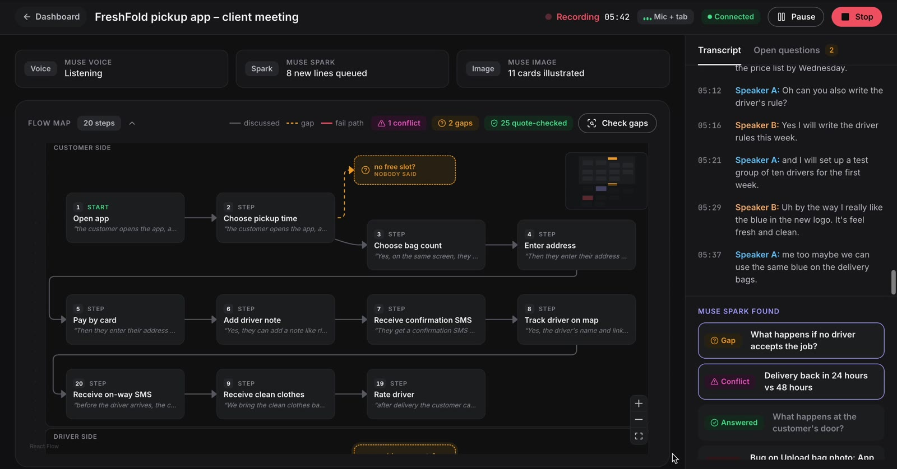
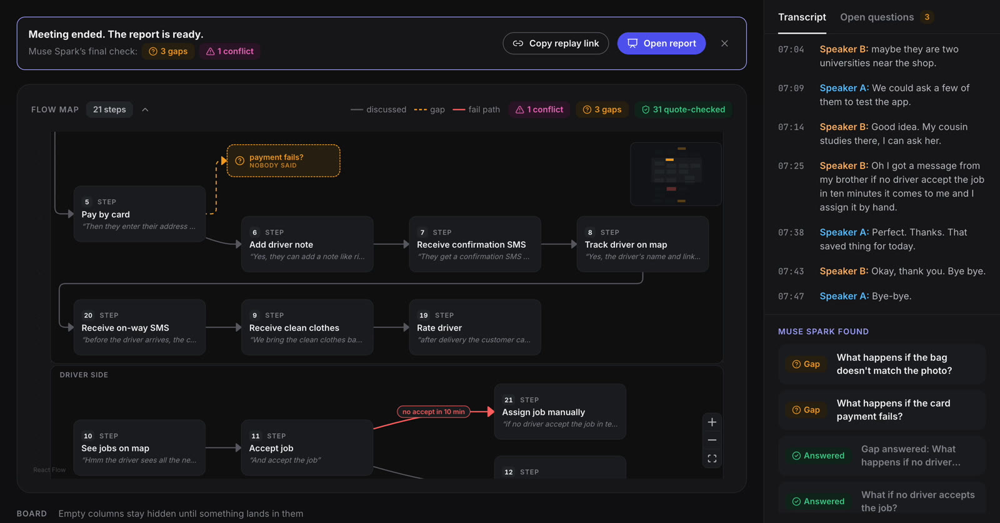
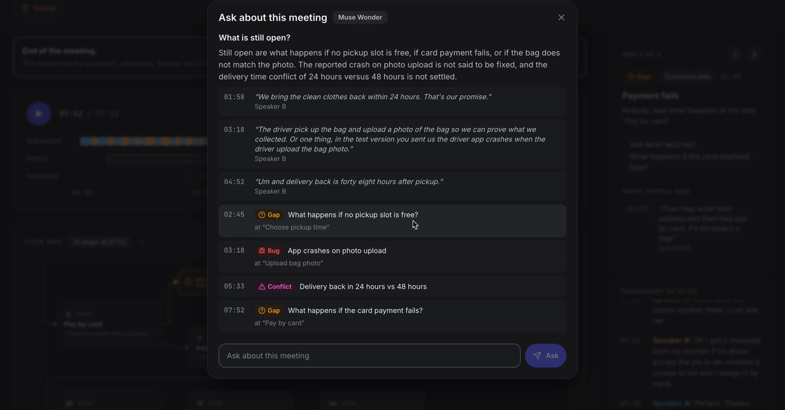
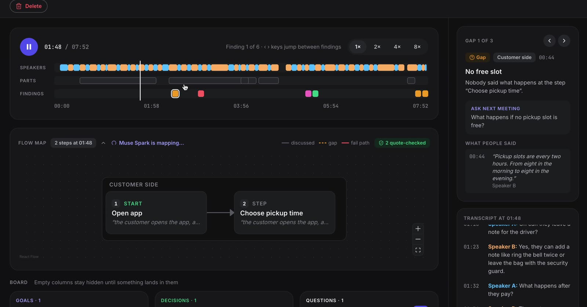

# MinuteCanvas

**Notes tell you what was said. MinuteCanvas shows what was missed.**

MinuteCanvas listens to a live meeting and draws it while people talk. When a client describes how their product should work, a Muse Spark agent draws the flow step by step, then points out what nobody said: the open question, the two statements that disagree, the reported bug.

Built solo for the **Meta Global AI Developer Hackathon 2026** with four Meta models: **Muse Voice Transcribe, Muse Spark, Muse Image and Muse Wonder** (Meta Model API).

▶ **Demo video:** https://youtu.be/LxewCZfo5ko · **Post on X:** https://x.com/i/status/2118107110081007803

🌐 **Try it:** https://d56fdtsmdd5nf.cloudfront.net — no account needed. Best with a real conversation between two or more people (for example a Google Meet call in Chrome, using the "Mic + meeting tab" option), so the Flow Map has a flow to draw and questions to catch.



---

## What it does

| | |
|---|---|
| **Live Flow Map** | A Muse Spark tool-calling agent draws the flow the client describes, live, one band per product part. Click any box to see the exact words it came from. |
| **Gaps** | A path nobody covered becomes a dashed question box ("What if no driver accepts the job?"). Open gaps are re-checked as the meeting goes on; when a later answer closes one, it turns green. |
| **Conflicts** | Two statements that disagree, shown with both quotes and who said them ("24 hours" vs "48 hours"). MinuteCanvas never decides who is right. |
| **Bugs** | A reported bug is pinned in red on the exact step. |
| **Live board** | Goals, decisions, actions, updates and questions, each card with a small picture from Muse Image. |
| **Report** | After Stop: slides with the summary and key takeaways written by Muse Wonder, export as PDF. |
| **Ask about this meeting** | Ask a question; Muse Wonder answers only from what was said and found, and shows the real quotes. No evidence → "The meeting didn't cover this." |
| **Shareable replay** | A text replay that plays the meeting back from 00:00 (transcript, board, Flow Map). Jump straight to the moment a finding appeared. |

Audio can come from your mic, or your mic plus a Google Meet / Zoom tab in Chrome.

| After Stop: the final pass answers a gap (green) | Ask about this meeting (Muse Wonder) |
|---|---|
|  |  |



## How the four Meta models are used

```
browser audio (PCM16, 24 kHz)
   │
   ▼
Muse Voice Transcribe ── live transcript with speakers (diarization)
   │
   ▼  every round
Muse Spark ─┬─ board cards (goals / decisions / actions / updates / questions)
            └─ Flow Map agent: add_step · link_steps · update_step · report_bug
                               flag_gap · flag_contradiction · resolve
                 every call must quote the transcript → checked by our code → refused if not really said
   │
   ├─ Muse Image ── one picture per board card
   │
   ▼  after Stop
Muse Wonder ── report summary + key takeaways, and "Ask about this meeting"
               (returns line / finding ids → server keeps only real ones → real quotes shown)
               Muse Spark is the fallback.
```

- **Quote-checked agent.** The Flow Map is changed one small tool call at a time instead of being rewritten, and every call has to quote what was said. The server checks the quote against the transcript and refuses the call if it doesn't match, so every box on the map is backed by real words.
- **Second opinions.** Separate Spark checks confirm conflicts and gaps before they are shown; open gaps are re-checked during the meeting and in a final pass after Stop.
- **Reliable live audio.** A real-time pacer, session rotation before the 60-minute voice limit and a resend of unconfirmed audio keep transcription running through network drops.
- **Measured.** In a live run on a real 32-minute product meeting, the Flow Map drew 24 of 24 expected steps and 14 of 14 links, found the real gap and both real conflicts, with 0 false gaps and 0 false conflicts. A transcript test bench (`backend/bench`) scores steps, arrows, gaps and conflicts against answer keys.

## Privacy

- Audio is never saved.
- The text replay (transcript, board, Flow Map, card images) is kept for 30 days and can be deleted any time.
- No account is needed to start a meeting. Google sign-in (email and name only) is optional, to keep meetings in one list across devices.
- The Meta API key lives only on the server.
- A mandatory "everyone knows it is being transcribed" checkbox before every meeting, plus a ready-made notice to paste into the meeting chat.

## Tech stack

- **Backend:** Python, FastAPI + WebSockets (`backend/`)
- **Frontend:** Next.js (App Router), React, TypeScript, React Flow (`frontend/`)
- **Hosting:** one AWS EC2 server (Docker Compose, Caddy) behind Amazon CloudFront

## Run locally

Backend (terminal 1):
```bash
cd backend
python3 -m venv .venv && source .venv/bin/activate
pip install -r requirements.txt
cp .env.example .env
uvicorn app.main:app --port 8000
```
Put your `META_API_KEY` in `backend/.env`, or set `MOCK_META=1` there for a fake meeting that uses no credits.

Frontend (terminal 2):
```bash
cd frontend
npm install
cp .env.example .env.local
npm run dev
```
Open http://localhost:3000 in Chrome.

Tests: `pip install pytest pytest-asyncio`, then `python -m pytest -q` in `backend/` (fake Meta API, no credits).

More detail: [`backend/README.md`](backend/README.md) (protocol, replay, deploy, security) and [`frontend/README.md`](frontend/README.md) (pages, design).

## License

MIT — see [LICENSE](LICENSE).
